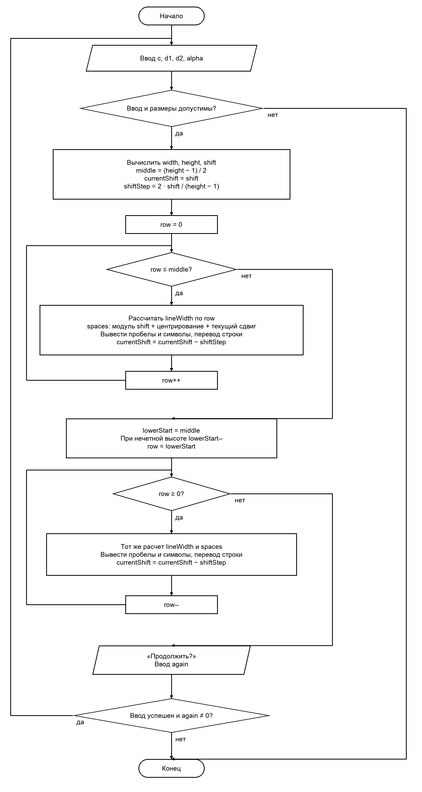

# Домашнее задание к работе №9
Вариант 15

## Условие задачи
Вывести заполненный четырехугольник заданным пользователем символом. Пользователь задает две диагонали d1, d2 (целые числа) и угол между ними.

Упрощение: точка пересечения делит обе диагонали пополам, получается параллелограмм. Остальные параметры по условию разрешено выбирать константами.

Размеры задаются в символах, без растяжения по горизонтали. d1 — полная ширина самой широкой строки. Количество строк — целая часть d2·sin(alpha). При угле 90° ввод 10 и 8 дает ширину ровно 10 символов и высоту ровно 8 строк. При другом угле вторая диагональ наклонена: высота — ее вертикальная проекция, после округления рисунок приблизительный. При четной высоте две средние строки имеют полную ширину.

Для такого способа рисования нужны ширина хотя бы 2 символа и высота хотя бы 3 строки. Символы для рисунка — однобайтовые, например *, #, @. При неверном формате ввода программа завершается.

## 1. Алгоритм и блок-схема
### Алгоритм:
1. Ввести символ, две целые диагонали и угол. Проверить формат ввода и допустимые значения.
2. Перевести угол в радианы. width = d1 — полная ширина; height = целая часть d2·sin(alpha) — число строк; shift = целая часть d2·cos(alpha)/2 — сдвиг верхней вершины. Требуются width ≥ 2, height ≥ 3.
3. middle = (height−1)/2 — число шагов от верхней вершины до широкой строки.
4. currentShift = shift. На каждой следующей строке он уменьшается на shiftStep = 2·shift/(height−1). Так верхняя и нижняя вершины сдвигаются в противоположные стороны.
5. Верхняя половина: перебирать row от 0 до middle. Ширина строки lineWidth = 1 + (width−1)·row/middle, то есть от 1 до width.
6. Отступ считать по шагам: spaces = shift; если spaces отрицательно — сменить знак; прибавить (width−lineWidth)/2 для центрирования; прибавить целую часть currentShift для наклона. Вложенными циклами вывести spaces пробелов и lineWidth символов, перевести строку. Уменьшить currentShift на shiftStep.
7. Нижнюю половину начать с middle, а при нечетной высоте — с middle−1, чтобы не повторять среднюю строку. Перебирать row в обратном порядке до 0, используя тот же расчет и печать. Ширина уменьшается до 1.
8. Спросить о продолжении. Если ввод успешен и again ≠ 0, повторить программу.

### Блок-схема:


## 2. Реализация программы
```c
#define _USE_MATH_DEFINES
#include <stdio.h>
#include <math.h>

// Вариант 15. Четырехугольник по двум диагоналям и углу между ними.
int main() {
    char c;
    int d1, d2;
    double alpha;
    double currentShift, shiftStep; // сдвиг текущей строки и его изменение за одну строку
    int width, height, shift;
    int middle, lowerStart, lineWidth, spaces, again;
    do {
        puts("Введите символ для рисунка (например * или #):");
        if (scanf(" %c", &c) != 1) return 0;
        puts("Введите длины диагоналей d1 и d2:");
        if (scanf("%d %d", &d1, &d2) != 2) return 0;
        puts("Введите угол между диагоналями в градусах:");
        if (scanf("%lf", &alpha) != 1) return 0;
        if (d1 <= 0 || d2 <= 0 || alpha <= 0 || alpha >= 180) {
            puts("Нужны положительные диагонали и угол от 0 до 180 градусов");
            return 0;
        }

        alpha = alpha * M_PI / 180;
        width = d1; // ширина самой широкой строки в символах
        height = (int)(d2 * sin(alpha)); // количество строк рисунка
        shift = (int)(d2 * cos(alpha) / 2); // сдвиг верхней вершины вправо или влево
        if (width < 2 || height < 3) {
            puts("Нужны ширина хотя бы 2 символа и высота хотя бы 3 строки. Увеличьте диагонали");
            return 0;
        }

        middle = (height - 1) / 2; // сколько шагов от верхней вершины до широкой строки
        currentShift = shift; // сначала сдвиг равен сдвигу верхней вершины
        shiftStep = 2.0 * shift / (height - 1);

        // Верхняя половина
        for (int row = 0; row <= middle; row++) {
            lineWidth = 1 + (width - 1) * row / middle;

            spaces = shift;
            if (spaces < 0) spaces = -spaces;
            spaces += (width - lineWidth) / 2;
            spaces += (int)currentShift;

            for (int col = 0; col < spaces; col++)
                putchar(' ');
            for (int col = 0; col < lineWidth; col++)
                putchar(c);
            putchar('\n');
            currentShift -= shiftStep;
        }

        lowerStart = middle;
        if (height % 2 != 0)
            lowerStart--; // при нечетной высоте средняя строка уже напечатана

        // Нижняя половина
        for (int row = lowerStart; row >= 0; row--) {
            lineWidth = 1 + (width - 1) * row / middle;

            spaces = shift;
            if (spaces < 0) spaces = -spaces;
            spaces += (width - lineWidth) / 2;
            spaces += (int)currentShift;

            for (int col = 0; col < spaces; col++)
                putchar(' ');
            for (int col = 0; col < lineWidth; col++)
                putchar(c);
            putchar('\n');
            currentShift -= shiftStep;
        }
        puts("Продолжить? (Да - введите любое число, Нет - введите 0)");
        if (scanf("%d", &again) != 1) return 0;
    } while (again != 0);
    return 0;
}
```

## 3. Результаты работы программы

Пример 1. Ввод:
```text
*
9 9
90
0
```
Вывод:
```text
Введите символ для рисунка (например * или #):
Введите длины диагоналей d1 и d2:
Введите угол между диагоналями в градусах:
    *
   ***
  *****
 *******
*********
 *******
  *****
   ***
    *
Продолжить? (Да - введите любое число, Нет - введите 0)
```

Пример 2. Ввод:
```text
#
10 8
90
0
```
Вывод:
```text
Введите символ для рисунка (например * или #):
Введите длины диагоналей d1 и d2:
Введите угол между диагоналями в градусах:
    #
   ####
 #######
##########
##########
 #######
   ####
    #
Продолжить? (Да - введите любое число, Нет - введите 0)
```

Пример 3. Ввод:
```text
*
20 12
60
0
```
Вывод:
```text
Введите символ для рисунка (например * или #):
Введите длины диагоналей d1 и d2:
Введите угол между диагоналями в градусах:
               *
            *****
         **********
      ***************
   ********************
   ********************
     ***************
       **********
        *****
          *
Продолжить? (Да - введите любое число, Нет - введите 0)
```

Пример 4. Ввод:
```text
@
10 6
130
0
```
Вывод:
```text
Введите символ для рисунка (например * или #):
Введите длины диагоналей d1 и d2:
Введите угол между диагоналями в градусах:
    @
 @@@@@@@@@@
 @@@@@@@@@@
     @
Продолжить? (Да - введите любое число, Нет - введите 0)
```

## 4. Информация о разработчике
Файко Андрей Юрьевич, бТИИ-262
